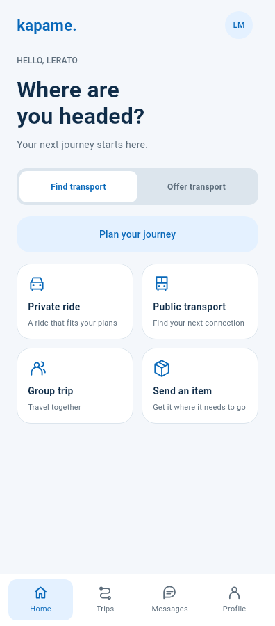
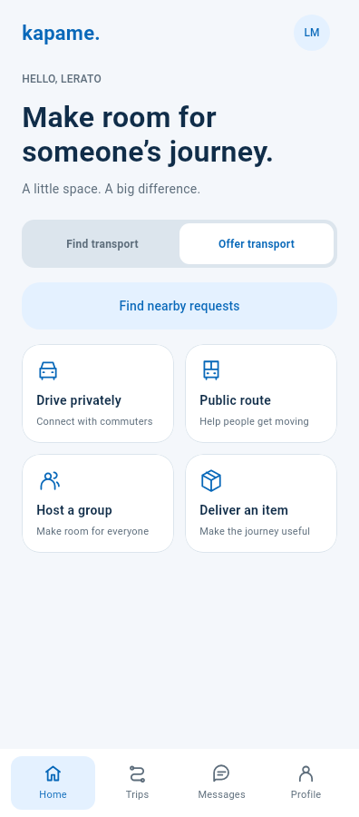
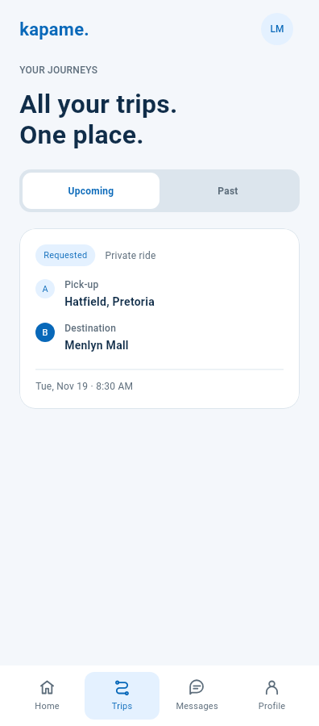
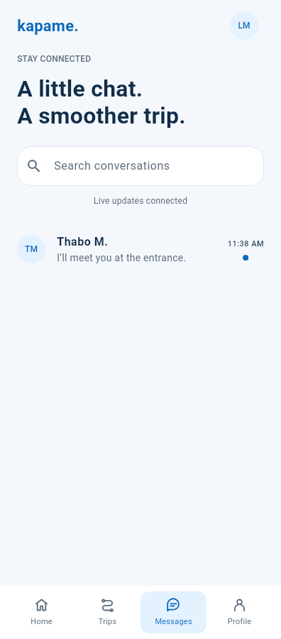
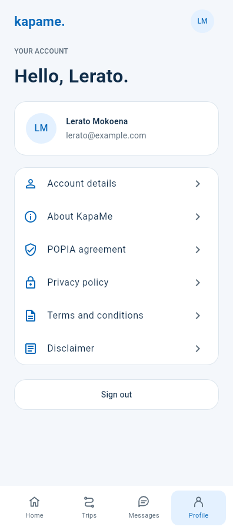
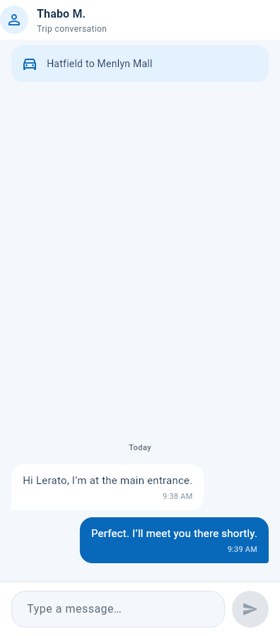
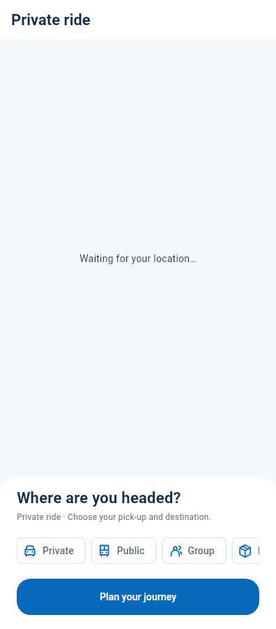
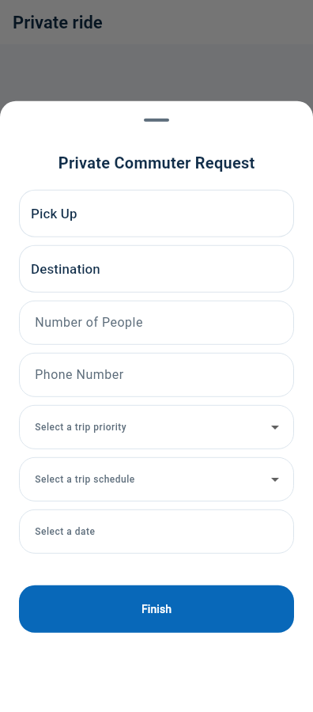

# Clear Blue visual rollout

Design reference: [KapaMe Clear Blue](https://www.figma.com/design/UEyMBlq1TERcemqacWKMUD?node-id=3-466).

The rollout adds shared Clear Blue colors, typography, fields, buttons and surfaces; a Find/Offer home screen; Home/Trips/Messages/Profile navigation; trip cards; an updated inbox and chat; and consistent controls around the existing Google Maps screens. All eight transport destinations remain available. Trip tabs show trips belonging to the signed-in requester or transporter and preserve the loaded result when switching tabs.

Google Maps, markers, route polylines, place selection, real ads, chat transport and existing booking/filter callbacks remain in use. The map's action panel stays available while location is pending. Transport shortcuts replace the current transport route, so Back still returns to the caller. Forms scroll above the keyboard; large-text map panels also scroll without covering the entire map.

This is a visual rollout using the current booking forms. It does not add the concept's separate three-step booking/review/confirmation workflow or change request payloads. Figma's MCP quota was exhausted after retrieving Home, Trips, Messages and Map Book detail; shared tokens/components were carried across the existing remaining views. No fake map tiles or sample trip data are shipped in the app.

## Screenshots

These are rendered Flutter widgets at 396 × 900 with synthetic review data, rather than HTML mockups. Native status bars are excluded. Ads are omitted in screenshots. The map screenshot deliberately shows the location-pending state: Google Maps tiles cannot render in the widget-test runner.

| Find transport | Offer transport |
| --- | --- |
|  |  |

| Trips | Messages |
| --- | --- |
|  |  |

| Profile | Chat |
| --- | --- |
|  |  |

| Map controls awaiting location | Existing booking form |
| --- | --- |
|  |  |

## Validation

- `flutter test --no-pub`: 48 tests pass; the opt-in screenshot generator is skipped.
- All eight service destinations, trip ownership/tab filtering, retry behavior and existing chat regressions are covered.
- Home is checked at 320 × 568, 396 × 900 and 800 × 600 with 2× text. All eight map forms are checked at 320 × 568 with normal/2× text and a keyboard inset.
- `flutter build apk --debug --no-pub`: passes with Flutter 3.38.4 / Dart 3.10.3.
- `flutter analyze --no-pub`: no errors; existing warnings and lint findings remain in legacy code. This is not a clean-analyzer claim.
- SVG assets were checked for nonzero size and native 26 × 26 service / 20 × 20 navigation and map dimensions. They are bundled locally.

No Android device or emulator was connected during validation. Before release, review actual map tiles/attribution, location permissions, ads, real account data, booking submission and live chat on a device. Widget tests mock platform services and do not submit trips.

The resolved SVG dependencies require Flutter 3.38 / Dart 3.10 or later, matching the development SDK used for this build.

To regenerate screenshots from the worktree:

```sh
FLUTTER_ROOT=/path/to/flutter flutter test --no-pub test/clear_blue_review_test.dart --dart-define=CAPTURE_REVIEW=true
```

Screenshots are review artifacts, not golden-test baselines. Their fixture data lives only in tests.
