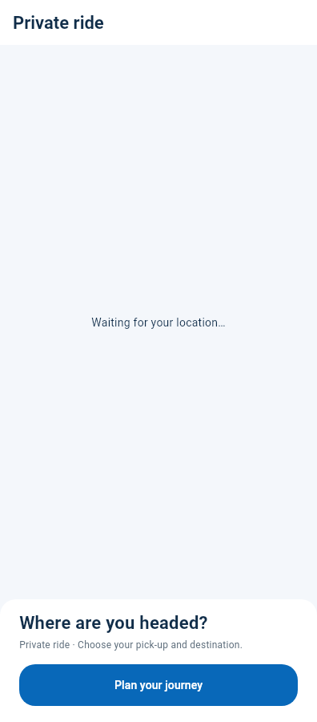

# Focused trip pages

Removed competing service choices from all eight selected trip pages. Service selection stays on Home; maps and existing booking forms remain.

## Review screens



## Validation

Full suite: 71 passed, 1 skipped before adding the opt-in capture test. Map and home tests: 20 passed. Screenshot capture passed.

The screenshot shows a location-pending test fixture. Native map tiles, permissions and live booking still need a device smoke test. No Android APK build was run for this feature.

Screenshots render production widgets with synthetic review data. Recreate them from this worktree:

```sh
FLUTTER_ROOT=/path/to/flutter flutter test --no-pub test/focused_trip_pages_review_test.dart --dart-define=CAPTURE_REVIEW=true
```
