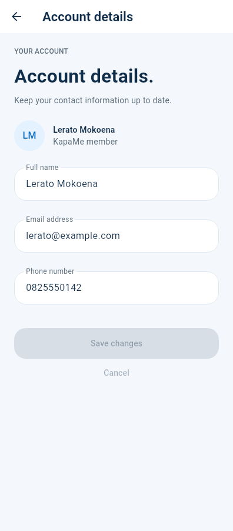
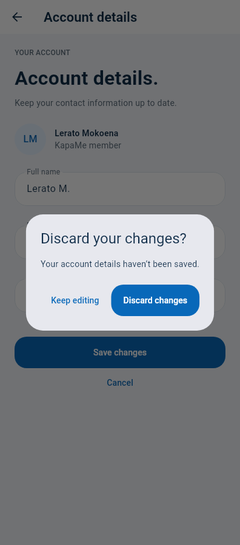

# Profile editing consistency

Clear Blue account details with prefilled fields, Save/Cancel, unsaved-change protection, retained drafts after failures, and session-preserving updates.

## Review screens





## Validation

Full suite: 74 passed, 2 skipped. Final label adjustment: 3 behavior tests and screenshot capture passed. Targeted static analysis: no issues.

Save requests were tested with an injected Dio client, not the live API. No Android APK build was run for this feature.

Screenshots render production widgets with synthetic review data. Recreate them from this worktree:

```sh
FLUTTER_ROOT=/path/to/flutter flutter test --no-pub test/profile_edit_consistency_review_test.dart --dart-define=CAPTURE_REVIEW=true
```
