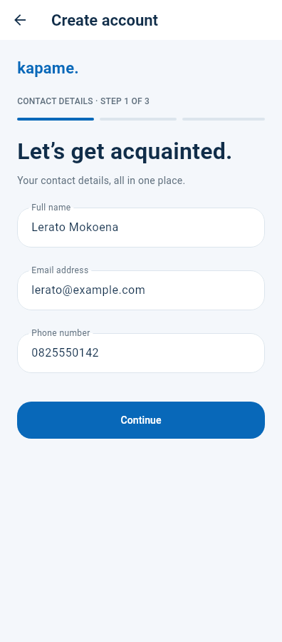
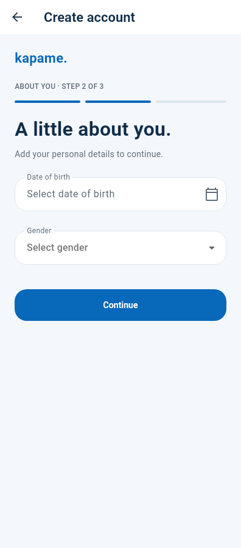
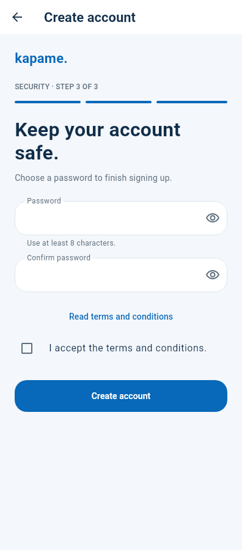

# Registration consistency

Matching date and gender fields, clearer step progress, persistent entries when moving between steps, and inline validation before account creation.

## Review screens







## Validation

Full suite: 73 passed, 2 skipped. Targeted static analysis: no issues. Screenshot capture passed.

Account submission was not exercised against the live API. No Android APK build was run for this feature.

Screenshots render production widgets with synthetic review data. Recreate them from this worktree:

```sh
FLUTTER_ROOT=/path/to/flutter flutter test --no-pub test/registration_consistency_review_test.dart --dart-define=CAPTURE_REVIEW=true
```
